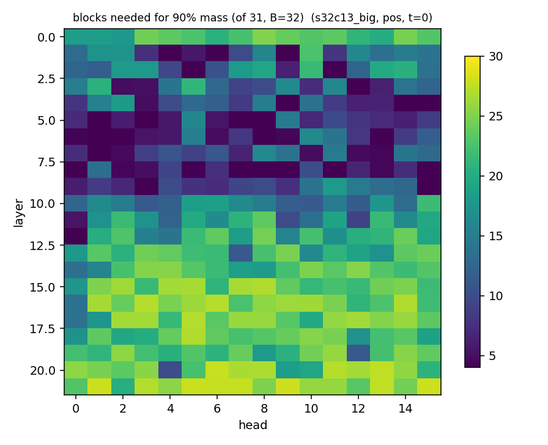

# DiT 注意力的稀疏结构：全量实测（22 层 × 16 头）

把 V5 DiT 每层每头的注意力**概率矩阵**（softmax 之后）落盘并做统计，回答两件事：
注意力到底稀疏在哪、这些规律能不能变成速度。

- 后端/硬件：Vulkan（`ggml-vulkan`，coopmat2）/ RTX 2070
- 权重：`gsv-v5dev-dit-f16all.gguf`（22 层 × 16 头 × head_dim 64，F32）、对照 `gsv-dit-f16all.gguf`
- 采样点：**全部 352 个头** × t ∈ {0, 0.25, 0.5, 0.75} × cond/uncond 两支
- fixture / 工况：

| 代号 | T | P（参考帧） | 步数 | cfg | 用途 |
|---|---|---|---|---|---|
| `s32c13_big` | 1000 | 500 | 32 | 1.30 | v5dev 首个 chunk（主数据） |
| `s4c0_big` | 1000 | 500 | 4 | 0 | turbo（无 CFG 支路）对照 |
| `chunk_geom_T672_P32` | 672 | 32 | 32 | 1.30 | **后续 chunk 的生产几何**（内容不自洽，见 §7） |
| `s32c13` / `s8c13` | 96 | 32 | 32 / 8 | 1.30 | 短句 |

- 复现：
  ```
  scripts\build-attn-scan.bat
  set GSV_DIT_ATTN_LEGACY=1 & set GSV_ATTN_MODE=summary & set GSV_ATTN_TS=0,0.25,0.5,0.75
  set GSV_ATTN_DUMP=<dir>
  tests\relcpu\probe_attn_scan.exe --device vulkan --models models --golden tests\golden --family s32c13_big
  python tests\report_attn_scan.py <scan_root> <out_dir>        # 全量汇总 + 图
  ```
  需要原始矩阵（4 MB/头）时把 `GSV_ATTN_MODE` 去掉，再用 `tests\analyze_attn_map.py` / `analyze_attn_structure.py`。




## 1. 结论速览

| 结论 | 数据（`s32c13_big`, pos, t=0, B=32 块 = 32 帧） |
|---|---|
| 块级稀疏度只有 **~0.48**，远低于之前用的 0.875 | 每行到 90% 质量需要 `b90/nb = 56%` 的块；全头平均可丢 **48.2%**，最优头 96.4% |
| 稀疏度**随深度单调下降** | 层 0–12：`b90 = 37.8%`；层 13–21：`b90 = 72.1%`；层 8 最稀疏（17.7%），层 21 最密（81.0%） |
| 参考段注意力**越深越均匀** | 归一化熵：层 0–12 平均 **0.658**，层 13–21 平均 **0.932**（1 = 完全均匀） |
| **与 t 几乎无关** | 全头均值 b90：16.6 → 17.0（t=0→0.75）；ent_ref 0.770 → 0.792 |
| **cond 与 uncond 同构** | 同一 t 下 b90 16.6 vs 16.6，ent_ref 0.770 vs 0.770 |
| 三种头型并存 | 均匀头 66/352、强局部头（\|k−q\|≤16 占 >35%）8/352、`maxblk32>0.25` 的集中头 135/352、`b90/nb≤0.25` 的稀疏头 70/352 |
| 没有注意力汇（sink） | 全局最大 key 列质量占比 ~0.4%，即平坦 |
| **参考段的"冗余"来自平坦，不来自稀疏** | 16 桶剖面均值 0.04–0.11（10 桶 ≈ 10%），跨头余弦中位 0.82 |

## 2. 分层剖面（`s32c13_big`，pos t=0，全头均值）

| 层 | b90/nb | ent_ref | maxblk32 | 该层最稀疏的头 |
|---|---|---|---|---|
| 0 | 68.9% | 0.875 | 0.13 | h2 (56%) |
| 1 | 35.9% | 0.583 | 0.41 | h9 (**4%**) |
| 2 | 42.5% | 0.714 | 0.37 | h5 (6%) |
| 3 | 36.7% | 0.657 | 0.37 | h12 (8%) |
| 4 | 28.8% | 0.626 | 0.46 | h15 (6%) |
| 5 | 22.1% | 0.512 | 0.49 | h1 (6%) |
| 6 | 23.3% | 0.511 | 0.51 | h1 (7%) |
| 7 | 28.4% | 0.643 | 0.46 | h1 (4%) |
| 8 | **17.7%** | 0.408 | 0.54 | h5 (6%) |
| 9 | 29.8% | 0.644 | 0.41 | h15 (9%) |
| 10 | 46.5% | 0.759 | 0.26 | h3 (35%) |
| 11 | 51.6% | 0.764 | 0.22 | h0 (17%) |
| 12 | 59.1% | 0.855 | 0.17 | h0 (8%) |
| 13 | 65.1% | 0.891 | 0.13 | h7 (35%) |
| 14 | 68.0% | 0.893 | 0.12 | h0 (43%) |
| 15 | 73.8% | 0.942 | 0.09 | h0 (55%) |
| 16 | 75.6% | 0.951 | 0.08 | h0 (43%) |
| 17 | 73.8% | 0.947 | 0.10 | h0 (43%) |
| 18 | 69.5% | 0.924 | 0.10 | h12 (54%) |
| 19 | 68.5% | 0.920 | 0.11 | h12 (35%) |
| 20 | 73.9% | 0.943 | 0.09 | h4 (32%) |
| 21 | **81.0%** | 0.977 | 0.07 | h2 (63%) |

前 13 层里 **144/208** 个头 `b90<50%`；后 9 层里只有 9/144 个头 `b90>85%`（即多数头几乎稠密）。

## 3. 各工况的稀疏度与上限

| 工况 | b90/nb（中位） | 平均可丢 | 最优头可丢 | DiT 上限加速（a=19.4%，均值/最优） |
|---|---|---|---|---|
| `s32c13_big` (T=1000,P=500) | 56.4% | 48.2% | 96.4% | **1.10x / 1.23x** |
| `s4c0_big` (turbo, cfg=0) | 58.0% | 47.1% | 96.9% | 1.10x / 1.23x |
| `chunk_geom_T672_P32`（后续 chunk 几何） | 59.2% | 46.1% | 95.2% | 1.10x / 1.23x |
| `s32c13` / `s8c13` (T=96,P=32) | 77% | 25.6% | 66.7% | 1.05x / 1.15x |

即：**按块 top-k 丢块的理论上限仍只有 ~1.10x**（因为注意力只占 DiT 的 19.4%），
和"注意力占比"这条天花板一致，与稀疏度是 0.48 还是 0.875 关系不大。

## 4. 更正："s ≈ 0.875 几乎免费"是什么意思

早先的 `ref_keep` 实验是**按 stride 均匀抽稀参考块**，丢 87.5% 后 mel relL1 只有 4e-3。
现在有了分布图就清楚了：参考段注意力本来就**接近均匀**（浅层熵 0.66、深层 0.93），
所以"丢大部分参考块不掉质量"的原因是 **信息冗余**（分布平坦，任何子集都 ≈ 均值），
而不是 **支撑稀疏**（少数块承载大部分质量）。

两个判据因此给出不同的 s：

| 判据 | s | 含义 |
|---|---|---|
| 质量（按 stride 丢块，实测 mel） | **0.875** | 丢掉的块"信息上冗余"，可以丢 |
| 质量（局部窗，实测 mel） | 0.87（gen×gen 内） | 生成段远端注意力可以砍 |
| 质量（块级质量占比 b90） | **0.48** | 按"哪个块质量大"来选，只能丢一半 |

二者不矛盾：**"能丢"不等于"按质量排序能选出来"**。b90 是"质量判据"，
质量实测是"冗余判据"。对实现而言这是关键区别：

- **top-k 选择**（SpargeAttention 路线）看重 b90 → 只有 0.48，上限 1.10x，还要写设备端选择 kernel；
- **均匀抽样 / 均值压缩 / pooled token** 看重冗余 → 0.875 可用，误差天然小，实现只要
  `sum_rows`/`pool_1d` + `flash_attn`（q 比 kv 短），**不需要新 kernel**。

## 5. 分层自适应：把两种办法用在对的层

由 §2 的深度剖面直接得到设计：

| 层段 | 现象 | 该用什么 |
|---|---|---|
| 0–12（浅，13 层） | `b90=37.8%`、熵 0.658、有 4–9% 的极稀疏头 | **块级 top-k**（可丢 ~60%），逐层逐头掩码 |
| 13–21（深，9 层） | `b90=72.1%`、熵 0.932（近均匀）、单块占比 ≤0.12 | 块 top-k 没用；**参考段均值/池化压缩**才对症 |

粗算（T=1000，注意力 T²）：浅层保留 0.38、深层用 `G×(G+32)=0.27T²` →
平均 `0.335 T²`，注意力本身 3x。叠加 §6 的生成行优化后才是大头。

## 6. 仍然是最大的那块：prompt 行（参考段查询）整段在空转

结构事实（已核代码）：

- `sample()` 把 `x[:, :P]` 初始化成 0，**每步更新后再次清零**；
- block 内都是逐 token 的（attention 查询行互不影响、FFN/adaLN 逐 token），`conv_pos` 只在 trunk 入口一次；
- 于是 prompt 行的 注意力→FFN→`vel` 从不被读取。

| 计算 | 现在 | 只算生成行（前缀 KV） | 省 |
|---|---|---|---|
| attention QK/AV | T×T | G×T | 50% |
| q/out 投影、FFN、adaLN-MLP | ∝T | ∝G | 50% |
| k/v 投影 | ∝T | ∝T | 0 |

粗算 DiT **1.5–1.9x**，且**输出逐位不变**。这条与稀疏度无关，是纯结构浪费。

## 7. 口径与限制

- `chunk_geom_T672_P32` 是把 `s32c13_big` 的 mu/noise 裁到最后 672 帧、prompt 裁到 32 帧得到的
  **几何仿真**：形状与生产后续 chunk 一致，但参考与 mu 内容不匹配，只能看结构统计，不能看音质。
- 采样走 `GSV_DIT_ATTN_LEGACY=1` 的逐头路径（唯一会物化 P 的路径），
  与默认 fused `flash_attn_ext` 数值不逐位一致，但统计结构一致。
- 块粒度固定 32 帧；`B=64`（cm2 的 `Bc`）下 b90/nb 会略差（块更大、更粗）。
- 统计口径是"质量占比"，不是"丢块后的音质"；音质结论沿用 `ref_keep` 与窗口实验的实测值。
- 单 fixture、单 seed；跨文本/跨参考稳定性未测。
