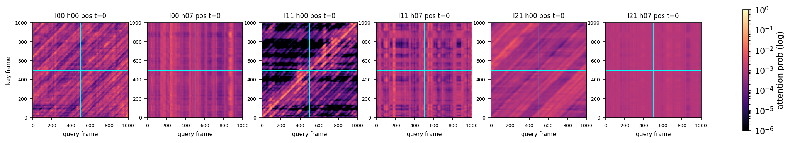
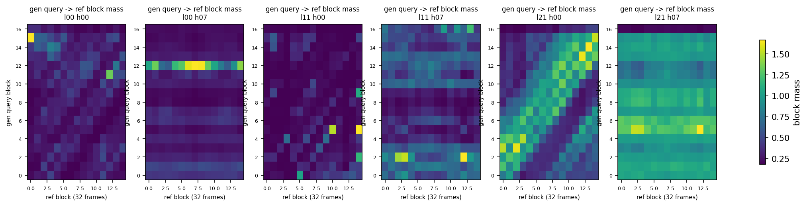

# DiT 注意力的稀疏结构：实测地图与规律

本文把 V5 DiT 每层每头的注意力**概率矩阵**（softmax 之后）直接落盘并分析，回答两个问题：
注意力到底稀疏在哪、有没有可以利用的规律。

- 硬件/后端：RTX 2070 / Vulkan（`ggml-vulkan`，coopmat2）
- 权重：`gsv-v5dev-dit-f16all.gguf`，22 层 × 16 头 × head_dim 64，F32
- fixture：`s32c13_big`（**T=1000**，参考 P=500，生成 500，32 步，cfg=1.30）
- 采样点：t=0（最噪）与 t=0.5；层 0 / 11 / 21；头 0 / 7；cond 与 uncond 两支都取了
- 复现：
  ```
  scripts\build-dit-opt.bat
  set GSV_DIT_ATTN_LEGACY=1
  set GSV_ATTN_DUMP=J:\path\to\dir
  set GSV_ATTN_LAYERS=0,11,21 & set GSV_ATTN_HEADS=0,7 & set GSV_ATTN_TS=0,0.5
  tests\relcpu\test_dit_opt.exe --device vulkan --models models --golden tests\golden --family s32c13_big
  python tests\analyze_attn_map.py <dir>      # 汇总 + 出图
  python tests\analyze_attn_structure.py <dir> # 均匀性/汇/块集中度/跨步相关
  ```





## 1. 结论速览

| 观察 | 数据 |
|---|---|
| **块级并不稀疏**：B=32 时每行要 21–28 个块（共 31 块）才到 90% 质量 | 见下表 C；只有 l11 h00 例外（7.2 块） |
| **参考段的注意力≈均匀**（多数头） | l21 h07 归一化熵 **0.999**、与平均剖面的 relL1 **0.21**；l11 h07 熵 0.955 |
| 少数头**极不均匀**：集中在参考尾部个别块 | l11 h00 熵 0.690、单块最高占 **51.6%**；l00 h07 的质量几乎全落在参考**第 12 块**（384–416 帧） |
| **生成段是局部带**（不是块稀疏） | gen×gen 里 \|k−q\|≤16 占 9–55%，≤128 占 39–93%（逐头差异大） |
| **没有全局注意力汇**（sink） | 全局 top-3 key 各只占 0.10%，即完全平坦 |
| **cond 与 uncond 结构几乎一致** | 两个分支的象限占比/带宽/集中度差异 <2 个百分点 |
| **跨步稳定** | t=0 vs t=0.5 全矩阵相关 0.76–0.99，参考段剖面相关 0.89–0.99 |
| **层间差异大** | 块级 top-25% 选择的 Jaccard：层 0 vs 层 21 只有 **0.10**；且层 0 跨步只有 0.49 |

## 2. 三种头型

把 6 张图并排看，头可以粗分成三类（同一个模型里三种都有）：

1. **全局平均头**（l21 h07）：整张图近乎一个常数，对参考/生成、对位置都不挑。
   这类头等价于「对全部 K/V 求平均」，用**均值压缩**可以几乎无损地替代。
2. **键位置偏置头**（l00 h07、l11 h07）：图像呈**竖条纹**——只看键的位置不看查询，
   典型是「固定盯参考某几块」（l00 h07 ≈ 参考第 12 块；l11 h07 ≈ 参考第 2、12–13 块）。
3. **局部带 / 对齐头**（l11 h00、l21 h00）：强对角线（\|k−q\| 小），
   且在 gen→ref 的块图上呈"生成位置 ↔ 参考位置"的斜纹；l11 h00 在参考键侧还有明显的
   **黑色横带**（部分参考块几乎不被任何查询看到）。

## 3. 定量表

### A. 象限质量占比（gen 查询在参考键上的质量）

| 层/头 | t | gen→ref | gen→gen | ref→ref | gen×gen 带宽 w=16 / 32 / 64 / 128 |
|---|---|---|---|---|---|
| l00 h00 | 0 | 0.524 | 0.476 | 0.453 | 0.185 / 0.222 / 0.273 / 0.392 |
| l00 h07 | 0 | 0.527 | 0.473 | 0.512 | 0.101 / 0.179 / 0.284 / 0.465 |
| l11 h00 | 0 | 0.130 | 0.870 | 0.933 | 0.555 / 0.568 / 0.713 / 0.926 |
| l11 h07 | 0 | 0.494 | 0.506 | 0.516 | 0.090 / 0.148 / 0.234 / 0.396 |
| l21 h00 | 0 | 0.645 | 0.355 | 0.379 | 0.089 / 0.129 / 0.204 / 0.406 |
| l21 h07 | 0 | 0.501 | 0.499 | 0.502 | 0.071 / 0.134 / 0.248 / 0.454 |

（neg 分支同量级，差 <0.02；t=0.5 同量级）

### B. 块级集中度（B=32，每行 31 块）

| 层/头 | 最大块占比 | 90% 质量需要块数 | 99% |
|---|---|---|---|
| l00 h00 | 0.128 | 21.8 | 30.0 |
| l00 h07 | 0.045 | 27.4 | 31.1 |
| **l11 h00** | **0.516** | **7.2** | 17.2 |
| l11 h07 | 0.063 | 25.2 | 30.8 |
| l21 h00 | 0.100 | 23.5 | 30.9 |
| l21 h07 | 0.036 | 28.1 | 31.0 |

即：**按块 top-k 选不出多少东西**（除了 l11 h00 这种"汇头"）。

## 4. 对"稀疏度 0.875 几乎免费"这条旧结论的更正

早先的实验（`ref_keep`）是**按 stride 均匀抽稀参考块**，丢掉 87.5% 后 mel relL1 只有 4e-3。
那张图现在有了：参考段的注意力本来就是**近似均匀**的，
所以"丢掉大部分参考块不掉质量"的真正原因是 **信息冗余（分布平坦、任何子集都≈均值）**，
而不是 **质量集中在少数块上（稀疏支撑）**。

这两件事对工程的含义完全相反：

- 如果按 SpargeAttention 的两阶段做 **top-k 块选择**，参考段**没有可选的少数块**，
  收益上限就是 §7 里算过的 1.13–1.20x，且要先写设备端选择 kernel；
- 如果是**把参考块平均压缩**（mean-K/mean-V，或用少量 pooled token 替代 500 个参考键），
  由于分布本来就平，误差天然极小，而实现只需要 `sum_rows/pool_1d` + `flash_attn`（n_q < n_kv），
  不需要新 kernel。

## 5. 更大的一条：**参考段（prompt 行）的查询侧计算完全是浪费**

这不是近似，是结构事实（本次顺带核实）：

- `sample()` 把 `x[:, :P]` 初始化成 0，并在**每一步更新后再次清零**（`memset(..., P*4)`），
  所以 prompt 区的 x 恒为 0；
- DiT 每个 block 都是逐 token 的（attention 的查询行互不影响、FFN/adaLN 逐 token），
  `conv_pos` 只在 trunk 入口做一次；
- 因此 prompt 行的**注意力输出 → FFN → 输出行**只影响 prompt 行自己的 `vel`，而 `vel` 的
  prompt 段**从不被使用**（x 的 prompt 段一直被清零，输出也只取生成段）。

推论（精确，无质量损失）：

| 计算 | 现在 | 只算生成行（前缀 KV） | 省 |
|---|---|---|---|
| attention QK/AV | T×T | G×T | 50%（T=1000/G=500） |
| q / out 投影、FFN、adaLN-MLP | ∝T | ∝G | 50% |
| k / v 投影 | ∝T | ∝T（参考键仍要算） | 0 |

粗算 DiT 整体 **1.5–1.9x**（attention 占 19.4%，其余矩阵乘占大头且同样减半），
且**不改变任何输出位**。再叠加第 4 点的参考块平均（gen 查询只看 ~32 个 pooled 参考键），
attention 的 T×T 可以降到 G×(G+32) ≈ 0.27T²，合计更可观。

## 6. 下一步（按性价比排序）

1. **前缀 KV 化 step 图**：`q/o/FFN` 只对生成段算，`k/v` 对全 T 算，attention 用
   `n_q=G, n_kv=T`（现有 `ggml_flash_attn_ext` 支持 q 短于 kv）。这是**精确**优化，
   用 `test_dit_opt` 的 A-B 逐位比对即可验证。
2. **参考段均值压缩**：把 500 个参考键/值按 32 帧池化成 16 个（或 64 帧 8 个）token，
   只对生成查询使用；用 `ref_keep` 的既有结论预估质量代价 <5e-3 relL1。
3. 若要保留近似稀疏：**按层**做掩码（层间几乎不共享，Jaccard 0.10），但可以**跨步复用**
   （相关 0.76–0.99）——即"每 chunk 算一次选择"而不是每步一次，避开 §7 里设备端动态选择的坑。

## 7. 口径说明（限制）

- 只取了 3 层 × 2 头；不排除其它层/头有更强结构（`GSV_ATTN_LAYERS/HEADS` 可扩）。
- 采样走的是 `GSV_DIT_ATTN_LEGACY=1` 的逐头路径（只有那条路径会物化概率矩阵）；
  与默认 fused `flash_attn_ext` 路径数值上不是逐位相同，但统计结构一致。
- 只看了首个 chunk（T=1000，P=500）；后续 chunk（T=672，P=32）的形状不同，结论需复核。
- 全部为单 fixture、单 seed；跨文本/跨参考的稳定性未测。
